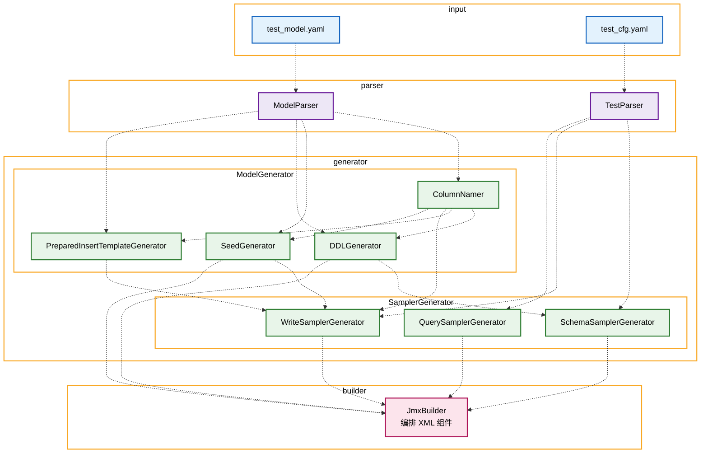
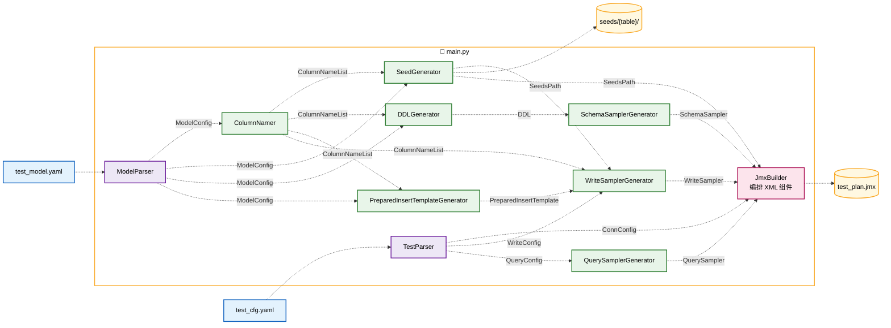
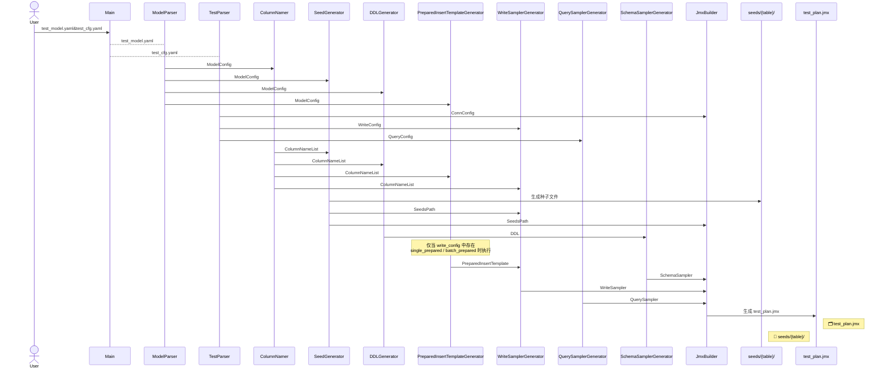

# KaiwuDB SVT 测试计划生成器 — 设计文档

## 1. 概述

本文档描述通用 JMeter 测试计划生成器的软件架构与实现方案。生成器读取两种 YAML 配置文件（`test_model.yaml` 模型配置、`test_cfg.yaml` 测试配置），输出：

- **JMeter 测试计划文件**（`.jmx`）
- **列种子缓存文件**（每表一个子目录，每列一个数据文本文件，文件每行为一个种子数据）

---

## 2. 架构总览

### 2.1 分层架构



* 连线含义见 **§11.1 图例说明**

### 2.2 层间依赖关系

规格书 §2.0 将输入分为两份 YAML：`test_model.yaml`（数据库场景模型）与 `test_cfg.yaml`（测试运行时配置）。两者在代码中通过不同的解析管线处理，到生成阶段再汇合。

#### 数据流路径



* 颜色与连线含义见 **§11.1 图例说明**

**关键设计决策：**

1. **双配置解耦**：`test_model.yaml` 定义数据库模型与种子数据（库/表/列结构、`seed_num`、`val_range`），`test_cfg.yaml` 定义运行时行为（吞吐量、线程数、查询 SQL）。两者在代码中通过不同解析管线处理，到生成阶段再汇合。此分离使同一数据模型可被不同压测策略复用。

2. **种子数据与 JMX 分离输出**：种子缓存文件按表目录独立落盘，JMX 中仅保留文件路径引用，不在 JMX 内嵌种子数据。查询时的 `?` 占位符由 JMeter 运行时从种子文件随机采样赋值，降低 JMX 体积并支持超大 `seed_num`。

3. **关系表与时序表职责分离**：关系表（`rel_dbs`）作为元数据表，仅在测试启动阶段初始化写入一次，不参与 `write_config` 的持续发压；时序表（`ts_dbs`）为性能测试主对象，按 `write_config` 配置持续写入。关系表的列种子生成方式与时序库表相同，行种子数据总集在 `SetupThreadGroup (DDL 执行)` 中由 `JSR223PreProcessor` 完成装配：行数取该表所有列 `seed_num` 的最大值，`seed_num` 较小的列按自身种子顺序循环填充，不进行笛卡尔积对齐；装配后的数据通过 `batch_insert` 策略由 `JDBCSampler` 一次性批量写入关系表。

4. **列名约定化与行种子总集**：所有 SQL（DDL、写入、查询）中的列名必须遵循 `{前缀}_{类型}_{序号}` 的固定格式（如 `col_int8_1`、`ptag_varchar_1`）。写入时不再按列独立随机采样，而是在 `SetupThreadGroup` 中一次性从列种子文件拼接出**行种子数据总集**并放入共享内存；所有写入线程共享同一块内存，每次写入随机拷贝连续 `batch_lines` 行，列间按表中列顺序绑定，不保持笛卡尔积对齐；`primary_tags` 的笛卡尔积仅用于设备唯一标识，不约束数据列的取值。

5. **多端协同设备隔离**：多 JMeter 端发压时，各端使用完全相同的测试计划（含 throughput），仅通过 `device_start` 参数划分设备范围。每张表独立计算：下一发压端起始设备号 = 本端起始设备号 + `num_threads` × `device_per_thread`。同一表在不同端之间设备号不重叠，不同表之间可重叠。

### 2.3 执行流水线

描述运行时各模块的调用顺序。种子生成、DDL 生成相互独立、可并行执行，其余阶段串行。



---

## 3. 模块详细设计

### 3.1 数据模型层 (`models.py`)

使用 **Pydantic V2** 定义两层数据模型。

#### 库级别模型

```python
class ModelConfig(BaseModel):
    """test_model.yaml 根模型"""
    rel_dbs: list[RelDbConfig] = Field(default_factory=list)
    ts_dbs: list[TsDbConfig] = Field(default_factory=list)


class RelDbConfig(BaseModel):
    """关系库配置"""
    name: str
    if_not_exists: bool = False
    with_encoding: str | None = None   # 无此属性时建库语句不含 WITH ENCODING
    comment: str | None = None
    tables: list[RelTableConfig] = Field(default_factory=list)


class TsDbConfig(BaseModel):
    """时序库配置"""
    name: str
    if_not_exists: bool = False
    retentions: str | None = None       # 数据保留策略，时序库专用
    partition_interval: str | None = None
    comment: str | None = None
    tables: list[TsTableConfig] = Field(default_factory=list)
```

#### 表级别模型

```python
class TableConfig(BaseModel):
    """表配置基类（关系表与时序表共用字段）"""
    name: str
    comment: str | None = None
    if_not_exists: bool = False
    data_col_count: int                 # 数据列总数
    data_cols: list[ColTypeConfig]      # 数据列类型配置


class RelTableConfig(TableConfig):
    """关系表配置"""
    primary_key_count: int
    primary_keys: list[ColTypeConfig]


class TsTableConfig(TableConfig):
    """时序表配置"""
    with_hash: int | None = None        # HASH 分桶数，取值 [1, 50000]
    ts_col: TsColConfig                 # 时间戳列配置
    primary_tag_count: int              # 主 tag 列总数（≤ 4）
    regular_tag_count: int              # 一般 tag 列总数
    primary_tags: list[ColTypeConfig]   # 值绑定到设备后固定不变，用于唯一标识时序数据源
    regular_tags: list[ColTypeConfig]   # 值在初始化时绑定到设备后固定不变


class TsColConfig(BaseModel):
    """时序表时间戳列配置"""
    name: str                           # 默认如 "ts"
    type: Literal["timestamp", "timestamptz"]
    ms_step: int                        # 时间戳步长，单位毫秒


class ColTypeConfig(BaseModel):
    """列类型定义（适用于 primary_keys / primary_tags / regular_tags / data_cols）"""
    col_type: str                       # 数据类型，内部统一小写处理
    type_proportion: float              # (0, 1]，同一列组下之和须等于 1.0
    val_range: str                      # 取值范围表达式或 ref 引用
    seed_num: int                       # 该类型需要预生成的种子数据行数
    nullable: bool = False              # 是否允许 NULL；false 时 DDL 附加 NOT NULL
    null_rate: float = 0.0              # NULL 占比 [0.0, 1.0]；仅 nullable=true 时生效
```

> **类型统一处理**：SQL 中数据类型名称大小写不敏感，生成器内部统一按全小写处理，输出 DDL 及模板中的类型名均为小写形式。

#### 测试配置模型

```python
class TestConfig(BaseModel):
    """test_cfg.yaml 根模型"""
    conn_config: list[ConnConfigItem]
    write_config: list[WriteConfigItem]
    query_config: list[QueryConfigItem] = Field(default_factory=list)


class ConnConfigItem(BaseModel):
    """库连接配置项，对应 JMeter 可变参数"""
    param_name: str                     # 不限于"db_url", "conn_pool_size", "device_start", "test_duration"这4个属性，可以根据需要扩展其他自定义配置属性
    default: str                        # 参数默认值，支持命令行覆盖


WriteMode = Literal[
    "single_insert", "batch_insert",
    "single_prepared", "batch_prepared",
    "schemaless",
]


class WriteConfigItem(BaseModel):
    """写入配置项，每张表独立配置"""
    tbl_name: str                       # "all" 表示所有表共用本配置；否则按表名单独配置
    throughput: float                   # 单端目标写入吞吐量，单位次/分钟
    mode: WriteMode                     # 写入方式（single_insert / batch_insert / single_prepared / batch_prepared / schemaless）
    batch_lines: int | None = None      # 批次写入条数；batch/schemaless 模式有效，默认 1
    device_per_thread: int              # 每线程负责的设备数
    num_threads: int                    # 写入线程并发数


QueryMode = Literal["statement", "prepared_statement"]


class QueryConfigItem(BaseModel):
    """查询配置项，每条查询生成独立查询线程组"""
    query: str                          # SQL 模板；列名须使用约定列名，? 为占位符
    throughput: float                   # 单端目标查询吞吐量，单位次/分钟
    mode: QueryMode                     # statement / prepared_statement
    num_threads: int = 1                # 查询线程并发数，默认 1
```


### 3.2 配置解析层 (`parser.py`)

职责：读取 YAML、校验、返回强类型数据模型。

```
parse_models(yaml_text) → ModelConfig
parse_test_cfg(yaml_text) → TestConfig
validate_consistency(models, cfg) → list[Error]
```

**校验规则：**

| 规则 | 检查项 | 错误级别 |
|------|--------|----------|
| R-PAR-001 | `type_proportion` 之和等于 1.0（容差 ±1e-9） | ERROR |
| R-PAR-002 | `seed_num > 0` | ERROR |
| R-PAR-003 | 关系表 `primary_key_count == len(primary_keys)` | ERROR |
| R-PAR-004 | 时序表 `primary_tag_count + regular_tag_count == len(primary_tags) + len(regular_tags)` | ERROR |
| R-PAR-005 | 时序表 `primary_tag_count <= 4` | ERROR |
| R-PAR-006 | Primary Tag 不支持 FLOAT4/FLOAT8 和变长非-VARCHAR 类型 | ERROR |
| R-PAR-007 | `ref:` 引用链中无循环引用 | ERROR |
| R-PAR-008 | `ref:` 目标存在且为主键列 | WARN(降级为不限范围) |
| R-PAR-009 | `val_range` 整数开区间内是否存在合法整数 | ERROR |
| R-PAR-010 | 查询 SQL 中的占位符数量 ≤ 关联列的 seed_num | WARN(取 min) |
| R-PAR-011 | `with_hash` 在 [1, 50000] 范围内 | ERROR |
| R-PAR-012 | `nullable` 为 bool 类型 | ERROR |
| R-PAR-013 | `null_rate` 在 [0.0, 1.0] 范围内 | ERROR |
| R-PAR-014 | `primary_tags` 中 `nullable` 必须为 `false` | ERROR |
| R-PAR-015 | `nullable=false` 时 `null_rate` 必须为 `0.0`；`nullable=true` 时 `null_rate` 允许为 `0.0` | ERROR |

### 3.3 列名生成器 (`column_namer.py`)

按规格定义的固定格式 `{前缀}_{类型}_{序号}` 生成列名：

```python
PREFIX_MAP = {
    "data_cols": "col",
    "primary_tags": "ptag",
    "regular_tags": "rtag",
    "primary_keys": "pk",
}

def resolve_column_groups(table: TableConfig) -> ColumnGroups:
    """根据 type_proportion 分配实际列数，生成列名列表。"""
```

**算法：**

对每个列组（如 `data_cols`），统一采用 **§5.1 `floor + 贪心` 算法** 分配实际列数，确保各类型列数之和严格等于 `count`：

1. 第一阶段：`floor(count × proportion)` 计算每种类型的基础列数。
2. 第二阶段：将剩余配额按小数部分从大到小贪心分配给对应类型。
3. 按配置的顺序遍历类型，依次为每种类型生成指定数量的列名。
4. 序号从 1 开始递增。

> 详细实现见 **§5.1 type_proportion 分配算法**。

**示例**：`data_col_count=4000`, 两种类型各 0.25 → 每种 1000 列：

```
col_int8_1 .. col_int8_1000
col_double_1001 .. col_double_2000
...
```

### 3.4 种子生成器 (`seed_gen.py`)

职责：根据列配置预生成种子数据，写入独立文件。

```
generate_seeds(model_config) → dict[filepath, bytes]
```

#### 值生成策略

按 `val_range` 类型分发到不同生成器：

| val_range 格式 | 处理方式 |
|---------------|---------|
| `>=N` / `<=N` / `>N` / `<N` / `=N` | 从合法区间均匀随机采样 |
| `[a,b]` / `(a,b)` 等区间表达式 | 按区间开闭规则采样；整数类型跳过非法值 |
| `^regex$` | 生成符合正则的字符串（简化版：按字符集拼接定长串） |
| `enum:v1,v2,...` | 顺序循环选取枚举值；当 `seed_num`（扣除 NULL 后的剩余数量）小于枚举值数量时，仅取前 `seed_num` 个枚举值，不再循环 |
| `ref:db.table.col` | 延迟处理（需等待被引用列的种子生成完毕） |

#### 外键种子处理

当检测到 `ref:` 引用时，两个表种子数据不隔离：

```
外部引用链解析流程：
1. 构建引用图 (db.table.col → 被引用的列)
2. 拓扑排序确定生成顺序
3. 对被引用列先生成种子
4. 引用列的种子直接从被引用列种子中采样
```

#### 输出格式

#### NULL 值生成策略

当 `nullable=true` 时，种子生成器在生成随机值前**先计算 NULL 数量**，按 `null_count = round(seed_num × null_rate)` 生成对应数量的 `null` 行，剩余配额再按 `val_range` 规则生成实际值。NULL 值与非 NULL 值在种子文件中**随机打乱后输出**，使 `null` 均匀分散在整列种子数据中，模拟真实场景下的缺失分布。

| 参数组合 | 行为 |
|----------|------|
| `nullable=false` | `null_rate` 无效，固定 `0.0`，全部生成非 NULL 值 |
| `nullable=true, null_rate=0.0` | 允许 NULL 但占比为 0，全部生成非 NULL 值（DDL 不附加 NOT NULL） |
| `nullable=true, null_rate=1.0` | 全部为 `null`，适用于测试全空列场景 |

> **注意**：NULL 值计入 `seed_num` 总数。如 `seed_num=10, null_rate=0.2`，则 2 行为 `null`，8 行为随机值，共 10 行。

#### 输出格式

每个种子文件为一行一个值的纯文本。文件名约定为：

```
{table_seed_dir}/{列序号}_{列名}.{类型名}
```

- `列序号`：按表中除时间戳列外的字段顺序从 1 开始自然数编号，读取时按列序号数值排序得到正确的列顺序。
- `类型名`：规范化后的基本类型名（不含长度/精度），如 `int8`、`varchar`。
- 第一个 Primary Tag 列的种子文件内容为占位串 `?ptag1?`，写入线程组按线程设备号替换为实际设备标识。

示例：

```
# 1_col_int8_1.int8 (nullable=false)
1
2
3
4
5
```

```
# 2_col_float4_1.float4 (nullable=true, null_rate=0.2, seed_num=10，null 值打散后)
0.0000000
null
1.0000000
2.0000000
null
3.0000000
4.0000000
5.0000000
6.0000000
7.0000000
```

### 3.5 数据库对象与写入模板生成

#### 3.5.1 DDL 引擎 (`ddl_generator.py`)

职责：根据模型配置生成 CREATE DATABASE / CREATE TABLE 语句。

```
generate_ddl(model_config) → list[DdlStatement]

@dataclass
class DdlStatement:
    db: str
    sql: str
    phase: DdlPhase  # CREATE_DB / CREATE_REL_TABLE / CREATE_TS_TABLE
```

#### 关系表建表语句模板

```sql
CREATE TABLE {db}.{table} (
    {pk_columns},
    {data_column_defs},
    PRIMARY KEY ({pk_columns})
);
```

#### 时序表建表语句模板

```sql
CREATE TABLE {db}.{table} (
    {ts_col.name} {ts_col.type} NOT NULL,
    {ptag_column_defs},
    {rtag_column_defs},
    {data_column_defs}
) TAGS ({ptag_column_defs}),
  PRIMARY TAGS ({ptag_names})
  {[RETENTIONS {retention}]}
  {[PARTITION INTERVAL {partition_interval}]}
  {[COMMENT [=] {comment}]}
  {[WITH HASH({hash})]};
```

**约束要求：**
- Primary Tag 列统一添加 `NOT NULL` 约束（`nullable` 强制为 `false`）
- `data_cols`、`regular_tags`、`primary_keys` 中 `nullable=false` 时附加 `NOT NULL`，`nullable=true` 时不附加
- Primary Tag 不允许浮点类型，VARCHAR 长度默认 64
- `WITH HASH` 必须放在可选参数最后位置
- 库级 `retentions` 在表级未指定时使用库级值

#### 3.5.2 Prepared Insert 模板生成器 (`prepared_insert_template_generator.py`)

职责：为使用 PreparedStatement 的写入方式生成带 `?` 占位符的 INSERT 模板语句。

```python
generate_prepared_insert_templates(
    model_config: ModelConfig,
    column_names: dict[str, ColumnNameList],
) -> dict[str, str]

# 返回：{table_fqn: insert_sql}
# 示例：
# {
#   "iot_monitor.t_cnc": "INSERT INTO iot_monitor.t_cnc (ts,ptag_float8_1,ptag_int8_1,rtag_varchar_1,col_int8_1,...) VALUES (?,?,?,?,?,...)",
# }
```

生成规则：

- 模板包含时间戳列及表中所有非时间戳列，列名顺序与建表字段顺序一致。
- 列名使用 §3.3 约定的 `{前缀}_{类型}_{序号}` 格式。
- 所有值位置均用 `?` 占位符表示，由运行时 `JSR223PreProcessor` 或 `JDBCSampler` 绑定具体参数。
- 关系表（`rel_dbs`）仅用于 `SetupThreadGroup` 中的元数据初始化，不走 `write_config` 的持续写入，因此**不参与** Prepared Insert 模板生成。

调用条件（关键）：

- `main.py` / `jmx_builder` 在汇总阶段检查 `write_config` 中所有表的 `mode`。
- **仅当存在 `single_prepared` 或 `batch_prepared` 模式时**，才实例化 `PreparedInsertTemplateGenerator` 并生成模板；否则跳过该步骤，不生成任何 INSERT 模板。
- 生成结果按 `表完全限定名（db.table）` 索引，供 `WriteSamplerGenerator` 在构造对应表的 `WriteStrategy` 时按需取用。

模板消费路径：

| 写入模式 | 消费方式 |
|----------|---------|
| `single_prepared` | 模板作为 `JDBCSampler.query` 的值，`queryType` 固定为 `Prepared Update Statement`，参数由 `JSR223PreProcessor` 绑定。 |
| `batch_prepared` | 模板注入为 JMeter 线程变量 `insert_sql`，供 `JSR223Sampler` 中的 Groovy 脚本读取并调用 `conn.prepareStatement(insertSql)`。 |

### 3.6 JMX 构建器 (`jmx_builder.py`)

职责：将解析后的配置、DDL SQL 和种子文件路径组装为 JMeter `.jmx` XML。其中 DDL SQL（建库建表语句）作为测试初始化步骤嵌入 JMX；种子缓存文件输出到独立目录，JMX 中仅保留引用路径。

采用 **XML 元素树逐节点构建** 而非模板字符串拼接，保证 XML 合法性和属性顺序可控。

#### 线程组编排结构

```
Test Plan
 ├── JDBCDataSource(连接池初始化)
 ├── SetupThreadGroup (DDL 执行)
 │    ├── JDBCSampler: 执行建库建表 DDL
 │    └── JDBCSampler: 初始化关系库下的元数据表（batch_insert，前置 JSR223PreProcessor 组装数据）
 ├── SetupThreadGroup: 初始化共享内存种子区
 │    └── JSR223Sampler: 从列种子文件拼接各表行种子总集并创建共享内存
 ├── ThreadGroup: 写入 t_cnc
 │    ├── ConstantThroughputTimer
 │    └── JSR223Sampler (batch_prepared JDBC batch)
 │         └── JSR223PreProcessor (获取基准时间 & 从共享内存行种子总集随机拷贝连续 batch 行并装配时间戳和第一个ptag)
 ├── ThreadGroup: 写入 t_motor
 │    ├── ConstantThroughputTimer
 │    └── JSR223Sampler (batch_prepared JDBC batch)
 │         └── JSR223PreProcessor (获取基准时间 & 从共享内存行种子总集随机拷贝连续 batch 行并装配时间戳和第一个ptag)
 ├── ThreadGroup: 查询 Q1
 │    ├── ConstantThroughputTimer
 │    └── JDBCSampler (prepared_statement)
 ├── ThreadGroup: 查询 Q2
 └── ThreadGroup: 查询 Q3
```

> **采样器类型说明**：`batch_prepared` 模式下，写入线程组使用 `JSR223Sampler` 手写 JDBC batch prepared statement（见「JSR223Sampler（batch_prepared）」）；`single_insert` / `batch_insert` / `single_prepared` 模式仍使用 `JDBCSampler`，通过 `queryArguments` 绑定参数。
>
> **注意**：JMeter 的线程组不能嵌套。`SetupThreadGroup` 与普通 `ThreadGroup` 之间是**并列关系**（而非从属关系），仅通过 JMeter 的执行机制保证 `SetupThreadGroup` 在其他线程组之前运行，用于完成连接池初始化、建库建表等 DDL、元数据种子插入以及行种子总集装配等前置操作。

#### 关键组件生成

##### 用户自定义参数配置

```xml
<Arguments guiclass="ArgumentsPanel" testclass="Arguments"
           testname="User Defined Variables" enabled="true">
  <collectionProp name="Arguments.arguments">
    <elementProp name="db_url" elementType="Argument">
      <stringProp name="Argument.name">db_url</stringProp>
      <stringProp name="Argument.value">jdbc:kaiwudb://127.0.0.1:26257/defaultdb</stringProp>
      <stringProp name="Argument.metadata">=</stringProp>
    </elementProp>
    <elementProp name="db_username" elementType="Argument">
      <stringProp name="Argument.name">db_username</stringProp>
      <stringProp name="Argument.value">root</stringProp>
      <stringProp name="Argument.metadata">=</stringProp>
    </elementProp>
    <elementProp name="db_password" elementType="Argument">
      <stringProp name="Argument.name">db_password</stringProp>
      <stringProp name="Argument.value"></stringProp>
      <stringProp name="Argument.metadata">=</stringProp>
    </elementProp>
    <elementProp name="conn_pool_size" elementType="Argument">
      <stringProp name="Argument.name">conn_pool_size</stringProp>
      <stringProp name="Argument.value">10</stringProp>
      <stringProp name="Argument.metadata">=</stringProp>
    </elementProp>
    <elementProp name="throughput" elementType="Argument">
      <stringProp name="Argument.name">throughput</stringProp>
      <stringProp name="Argument.value">60</stringProp>
      <stringProp name="Argument.metadata">=</stringProp>
    </elementProp>
    <elementProp name="num_threads" elementType="Argument">
      <stringProp name="Argument.name">num_threads</stringProp>
      <stringProp name="Argument.value">5</stringProp>
      <stringProp name="Argument.metadata">=</stringProp>
    </elementProp>
    <elementProp name="test_duration" elementType="Argument">
      <stringProp name="Argument.name">test_duration</stringProp>
      <stringProp name="Argument.value">604800</stringProp>
      <stringProp name="Argument.metadata">=</stringProp>
    </elementProp>
  </collectionProp>
</Arguments>
<hashTree/>
```

##### SetupThreadGroup

setUp 线程组，在主测试开始前执行（如 DDL、建库建表、初始化共享内存种子区等）。

```xml
<SetupThreadGroup guiclass="SetupThreadGroupGui" testclass="SetupThreadGroup"
                  testname="setUp Thread Group" enabled="true">
  <stringProp name="ThreadGroup.on_sample_error">continue</stringProp>
  <elementProp name="ThreadGroup.main_controller" elementType="LoopController"
               guiclass="LoopControlPanel" testclass="LoopController"
               testname="Loop Controller" enabled="true">
    <boolProp name="LoopController.continue_forever">false</boolProp>
    <stringProp name="LoopController.loops">1</stringProp>
  </elementProp>
  <stringProp name="ThreadGroup.num_threads">1</stringProp>
  <stringProp name="ThreadGroup.ramp_time">1</stringProp>
  <longProp name="ThreadGroup.start_time">1370729701000</longProp>
  <longProp name="ThreadGroup.end_time">1370729701000</longProp>
  <boolProp name="ThreadGroup.scheduler">false</boolProp>
  <stringProp name="ThreadGroup.duration"></stringProp>
  <stringProp name="ThreadGroup.delay"></stringProp>
</SetupThreadGroup>
<hashTree>
  <!-- 嵌套 Sampler / Controller 等 -->
</hashTree>
```

##### ThreadGroup

普通线程组，执行主要测试逻辑（写入、查询等）。

```xml
<ThreadGroup guiclass="ThreadGroupGui" testclass="ThreadGroup"
             testname="{group_name}" enabled="true">
  <stringProp name="ThreadGroup.on_sample_error">continue</stringProp>
  <elementProp name="ThreadGroup.main_controller" elementType="LoopController"
               guiclass="LoopControlPanel" testclass="LoopController"
               testname="Loop Controller" enabled="true">
    <boolProp name="LoopController.continue_forever">false</boolProp>
    <intProp name="LoopController.loops">-1</intProp>
  </elementProp>
  <stringProp name="ThreadGroup.num_threads">${num_threads}</stringProp>
  <stringProp name="ThreadGroup.ramp_time">${ramp_time}</stringProp>
  <longProp name="ThreadGroup.start_time">1373789594000</longProp>
  <longProp name="ThreadGroup.end_time">1373789594000</longProp>
  <boolProp name="ThreadGroup.scheduler">true</boolProp>
  <stringProp name="ThreadGroup.duration">${test_duration}</stringProp>
  <stringProp name="ThreadGroup.delay">${delay}</stringProp>
</ThreadGroup>
<hashTree>
  <!-- 嵌套 Timer / Sampler / PreProcessor 等 -->
</hashTree>
```

##### 多表写入线程数与变量隔离

当前版本要求所有写入线程组使用相同的 `num_threads`，因此线程组 XML 中可继续使用 `${num_threads}` 等全局变量。`write_config` 分条目指定不同表时，生成器需在配置校验阶段检查各表 `num_threads` 一致，不一致时生成阶段直接报错。

该约束用于简化每秒写入列数据数的计算与控制，并避免多张表配置不同 `num_threads` 时 JMeter 全局同名变量冲突的问题（见 [design-review-2026-06-11.md](design-review-2026-06-11.md) 第 13 项）。后续版本支持按表独立指定 `num_threads` 时，将采用以下任一方案避免冲突：

- **方案 A（推荐）**：在线程组 XML 的 `ThreadGroup.num_threads`、`ConstantThroughputTimer.throughput` 等属性中直接使用 `stringProp` 写入数字常量，不通过变量引用，减少变量复杂度。
- **方案 B**：为每张表生成独立的 JMeter 变量名，如 `${t_cnc_num_threads}`、`${t_motor_num_threads}`，并在对应线程组中引用这些独立变量。

##### 数据库连接配置

```xml
<JDBCDataSource guiclass="TestBeanGUI" testclass="JDBCDataSource"
                testname="JDBC Connection Configuration" enabled="true">
  <boolProp name="autocommit">true</boolProp>
  <stringProp name="checkQuery"></stringProp>
  <stringProp name="connectionAge">5000</stringProp>
  <stringProp name="dataSource">jdbcConfig</stringProp>
  <stringProp name="dbUrl">${db_url}</stringProp>
  <stringProp name="driver">com.kaiwudb.Driver</stringProp>
  <boolProp name="keepAlive">true</boolProp>
  <stringProp name="password">${db_password}</stringProp>
  <stringProp name="poolMax">${conn_pool_size}</stringProp>
  <stringProp name="timeout">10000</stringProp>
  <stringProp name="transactionIsolation">DEFAULT</stringProp>
  <stringProp name="trimInterval">60000</stringProp>
  <stringProp name="username">${db_username}</stringProp>
</JDBCDataSource>
<hashTree/>
```

##### 写入采样器模板

```xml
<JDBCSampler guiclass="TestBeanGUI" testclass="JDBCSampler" testname="{table}_写入" enabled="true">
  <stringProp name="dataSource">jdbcConfig</stringProp>
  <stringProp name="query">{generated_sql}</stringProp>
  <stringProp name="queryArguments">{param_refs}</stringProp>
  <stringProp name="queryArgumentsTypes">{param_types}</stringProp>
  <stringProp name="queryType">{query_type}</stringProp>  <!-- Update Statement / Prepared Update Statement -->
  <stringProp name="resultVariable"></stringProp>
  <stringProp name="variableNames"></stringProp>
</JDBCSampler>
<hashTree/>
```

> **注意**：`batch_prepared` 模式**不使用**上述 `JDBCSampler` 模板，而是使用 `JSR223Sampler` 手写 JDBC batch prepared statement，详见下方「JSR223Sampler（batch_prepared）」。

##### JSR223Sampler（batch_prepared）

`batch_prepared` 模式需要真正的批量 `PreparedStatement` 执行（`addBatch()` / `executeBatch()`），而 JMeter 原生 `JDBCSampler` 的 `Prepared Update Statement` 每次只绑定一组参数、执行一次，无法直接实现 batch。因此该模式改用 `JSR223Sampler`，在 Groovy 脚本中通过 `DataSourceElement.getConnection("jdbcConfig")` 获取 `JDBCDataSource` 定义的连接池连接，直接操作 JDBC `PreparedStatement`。

```xml
<JSR223Sampler guiclass="TestBeanGUI" testclass="JSR223Sampler" testname="{table}_batch_prepared写入" enabled="true">
  <stringProp name="scriptLanguage">groovy</stringProp>
  <stringProp name="filename"></stringProp>
  <stringProp name="parameters"></stringProp>
  <stringProp name="script">{generated_groovy_script}</stringProp>
</JSR223Sampler>
<hashTree/>
```

`JSR223Sampler` 下的 `JSR223PreProcessor` 负责准备当前批次数据，将装配完成的行列表写入线程变量 `__BATCH_ROWS_${tableName}`，供 Sampler 脚本读取。

```groovy
// 写入线程组 JSR223PreProcessor (groovy): 准备 batch_prepared 当前批次数据
def tableName = vars.get("table_name")
def sharedRows = props.get("__SHARED_MEM_${tableName}") as ArrayList<Object[]>

def batchLines = Integer.parseInt(vars.get("batch_lines") ?: "1")
def totalRows = sharedRows.size()
def startIdx = (int)(Math.random() * totalRows)

// 基准时间（每个线程首次执行时一次性获取）
if (vars.get("base_time") == null) {
    vars.putLong("base_time", System.currentTimeMillis())
}
def baseTime = Long.parseLong(vars.get("base_time"))
def batchSeq = Long.parseLong(vars.get("batch_seq") ?: "0")
def msStep = Long.parseLong(vars.get("ms_step") ?: "1000")

// 设备号计算（本线程负责的设备范围）
def threadNum = ctx.getThreadNum()
def deviceStart = Long.parseLong(vars.get("device_start") ?: "1")
def devicePerThread = Integer.parseInt(vars.get("device_per_thread") ?: "1")
def localDeviceStart = deviceStart + threadNum * devicePerThread

def batchRows = new ArrayList<Object[]>()
for (int i = 0; i < batchLines; i++) {
    def srcRow = sharedRows.get((startIdx + i) % totalRows)
    def rowCopy = srcRow.clone()
    // 替换第一个 Primary Tag 占位符为设备标识
    rowCopy[0] = "device_${localDeviceStart + (i % devicePerThread)}"
    // 装配时间戳（示例：时间戳列为 INSERT 的第一个参数）
    def ts = new java.sql.Timestamp(baseTime + batchSeq * msStep + (long)(i * msStep / batchLines))
    // 将时间戳追加到行数据末尾，Sampler 脚本按占位符顺序绑定
    rowCopy = Arrays.copyOf(rowCopy, rowCopy.length + 1)
    rowCopy[rowCopy.length - 1] = ts
    batchRows.add(rowCopy)
}

vars.putObject("__BATCH_ROWS_${tableName}", batchRows)
vars.put("batch_seq", String.valueOf(batchSeq + 1))
```

`JSR223Sampler` 脚本负责读取已准备好的批次数据，获取连接并执行 batch prepared statement。其中的 `insert_sql` 由 §3.5.2 的 `PreparedInsertTemplateGenerator` 生成，并作为 JMeter 变量注入当前线程：

```groovy
import org.apache.jmeter.protocol.jdbc.config.DataSourceElement

def tableName = vars.get("table_name")
def insertSql = vars.get("insert_sql")  // 由 PreparedInsertTemplateGenerator 生成，如 INSERT INTO db.table (ts, cols...) VALUES (?, ?, ...)
def batchRows = vars.getObject("__BATCH_ROWS_${tableName}") as ArrayList<Object[]>

def rowCount = batchRows.size()
if (rowCount == 0) {
    log.warn("No batch rows prepared for table ${tableName}")
    return
}

DataSourceElement.getConnection("jdbcConfig").withCloseable { conn ->
    conn.prepareStatement(insertSql).withCloseable { pstmt ->
        for (int rowIdx = 0; rowIdx < rowCount; rowIdx++) {
            def row = batchRows.get(rowIdx)
            for (int colIdx = 0; colIdx < row.length; colIdx++) {
                def value = row[colIdx]
                if (value == null) {
                    pstmt.setNull(colIdx + 1, java.sql.Types.NULL)
                } else {
                    pstmt.setObject(colIdx + 1, value)
                }
            }
            pstmt.addBatch()
        }
        pstmt.executeBatch()
    }
}
```

**关键设计要点：**

| 设计点 | 说明 |
|--------|------|
| **批量实现方式** | `JSR223Sampler` 中直接调用 `PreparedStatement.addBatch()` / `executeBatch()`，绕过 JMeter `JDBCSampler` 无法一次绑定多组参数的限制 |
| **连接来源** | 通过 `DataSourceElement.getConnection("jdbcConfig")` 复用 JMeter `JDBCDataSource` 连接池（`dataSource` 名称与设计文档 §3.6 连接配置中的 `jdbcConfig` 保持一致） |
| **职责划分** | `JSR223PreProcessor` 负责准备数据（行拷贝、时间戳、设备号），`JSR223Sampler` 负责 JDBC batch 执行，避免在 Sampler 中混合同步数据准备逻辑 |
| **NULL 处理** | 种子文件中的 `"null"` 在 PreProcessor 阶段已映射为 Java `null`，Sampler 脚本通过 `setNull()` 正确绑定 |
| **时间戳位置** | 由生成器根据表结构决定，示例中假设时间戳为 INSERT 的第一个参数；实际生成脚本按真实列顺序设置占位符索引 |

##### 查询采样器模板

查询采样器固定使用 `Prepared Select Statement`，所有 `?` 占位符由同线程组下挂载的 `JSR223PreProcessor` 在运行时从种子文件随机取值并注入。

```xml
<JDBCSampler guiclass="TestBeanGUI" testclass="JDBCSampler" testname="{query_name}" enabled="true">
  <stringProp name="dataSource">jdbcConfig</stringProp>
  <stringProp name="query">{query_sql}</stringProp>
  <stringProp name="queryArguments">${param_0},${param_1},${param_2}</stringProp>
  <stringProp name="queryArgumentsTypes">{param_types}</stringProp>
  <stringProp name="queryType">Prepared Select Statement</stringProp>
  <stringProp name="resultVariable"></stringProp>
  <stringProp name="variableNames"></stringProp>
</JDBCSampler>
<hashTree>
  <JSR223PreProcessor guiclass="TestBeanGUI" testclass="JSR223PreProcessor"
                       testname="{query_name}_param_prep" enabled="true">
    <stringProp name="scriptLanguage">groovy</stringProp>
    <stringProp name="script">{generated_groovy_script}</stringProp>
  </JSR223PreProcessor>
  <hashTree/>
</hashTree>
```

> **queryType 约定**：所有查询统一使用 `Prepared Select Statement`，不走直接 SQL。即使查询 SQL 为 `UPDATE` / `DELETE` 类语句，只要通过 `?` 注入参数，同样使用 PreparedStatement 执行。

关键属性说明：

| 属性 | 值 | 说明 |
|------|-----|------|
| `queryType` | `Prepared Select Statement` | 固定值，所有查询均走 PreparedStatement |
| `query` | `{query_sql}` | 保留原始 SQL 中的 `?` 占位符，由 JDBC 驱动解析为 PreparedStatement 参数 |
| `queryArguments` | `${param_0},${param_1},...` | JMeter 变量引用，每次执行前由 `JSR223PreProcessor` 从种子文件随机取值并刷新 |
| `queryArgumentsTypes` | `{param_types}` | 按占位符顺序提供 JDBC 类型（如 `VARCHAR,INTEGER,TIMESTAMP`），由生成器根据绑定列的 `col_type` 映射得到 |
| `JSR223PreProcessor` | `groovy` | 运行时脚本，详见 §5.3 `generate_query_param_script()` |

##### JSR223PreProcessor

在采样器执行前运行的脚本预处理器，用于修改变量、准备数据、计算动态参数等。

```xml
<JSR223PreProcessor guiclass="TestBeanGUI" testclass="JSR223PreProcessor"
                     testname="{preprocessor_name}" enabled="true">
  <stringProp name="filename"></stringProp>
  <stringProp name="parameters"></stringProp>
  <stringProp name="script">{generated_script}</stringProp>
  <stringProp name="scriptLanguage">groovy</stringProp>
</JSR223PreProcessor>
<hashTree/>
```

**关键属性：**

| Property | 类型 | 说明 |
|----------|------|------|
| `scriptLanguage` | string | 脚本语言：常用 `groovy` / `java` / `beanshell` / `javascript`；将对应语言的 jar 放入 JMeter `lib/` 目录后即可扩展更多语言 |
| `script` | string | 脚本内容（与 `filename` 二选一） |
| `filename` | string | 外部脚本文件路径 |
| `parameters` | string | 传入脚本的参数 |

> **性能提示：** 只有 **Groovy** 支持 JSR223 的 `Compilable` 接口，JMeter 可对其编译并缓存结果；`java` / `beanshell` / `javascript` 不支持编译缓存，每次执行都会重新解释脚本。性能敏感场景建议优先使用 **Groovy**。

**脚本内置变量：**

| 变量 | 说明 |
|------|------|
| `vars` | JMeterVariables 对象，用于读写线程变量 |
| `props` | JMeterProperties 对象，用于读写全局属性 |
| `log` | Logger 对象，用于日志输出 |
| `ctx` | JMeterContext 对象，当前线程上下文 |
| `prev` | SampleResult 对象，前一个采样器的结果 |

##### 共享内存行种子总集

`SetupThreadGroup: 初始化共享内存种子区` 在普通线程组之前执行，**使用单线程只执行一次**，为每张时序表从列种子文件拼接出完整的**行种子数据总集**，并放入全局共享内存。所有写入线程共享同一块内存，不再按线程拆分，也不再使用单独的实时数据生成线程组。

行种子总集的结构为 `ArrayList<Object[]>`：每个元素为一行，按建表字段顺序保存除时间戳外的各列值（第一个 Primary Tag 列保留占位串 `?ptag1?`）；总集行数等于该表各列 `seed_num` 的最大值，`seed_num` 较小的列按自身种子顺序循环填充。通过 `props.put("__SHARED_MEM_${tableName}", rows)` 全局保存。

##### 关系表初始化采样器

关系表（`rel_dbs`）在 `SetupThreadGroup (DDL 执行)` 中完成一次性初始化写入。其列种子文件生成规则与时序库表完全一致（见 §3.4），行种子数据总集的装配逻辑也与时序库表相同：

- **行数**：取该表所有列 `seed_num` 的最大值，即最长列种子文件的行数。
- **列间对齐**：不进行笛卡尔积展开；`seed_num` 较小的列按自身种子顺序循环复用，保证每行都有值。
- **NULL 处理**：种子文件中的字符串 `"null"` 映射为 Java `null`，由 JDBC 驱动按对应列类型处理为数据库 NULL。

关系表初始化采用 `batch_insert` 策略：数据装配由挂载在 `JDBCSampler` 前的 `JSR223PreProcessor` 完成，JDBC 执行仍由 `JDBCSampler` 负责。当总行数超过 `batch_lines` 时，生成器在 `JDBCSampler` 外生成 `Loop Controller`（或 `While Controller`）分批次写入，每次循环由 `JSR223PreProcessor` 装配一个批次，由 `JDBCSampler` 执行一次 `INSERT ... VALUES (...),(...)`。

`JSR223PreProcessor` 负责：

1. 按列序号排序读取该关系表的所有列种子文件。
2. 以最大 `seed_num` 为行数拼接行种子数据总集。
3. 按当前批次索引与 `batch_lines` 切分出本批次行，将所有列值依次写入 JMeter 变量 `param_0, param_1, ...`，供 `JDBCSampler` 的 `queryArguments` 引用。

`JDBCSampler` 配置：

| 属性 | 值 |
|------|-----|
| `queryType` | `Prepared Update Statement` |
| `query` | `INSERT INTO {db}.{table} ({columns}) VALUES ({placeholders}), ({placeholders}), ...` |
| `queryArguments` | `${param_0},${param_1},...,${param_N}` |
| `queryArgumentsTypes` | 按每行列顺序重复 `batch_lines` 次 |

```groovy
// SetupThreadGroup JSR223PreProcessor (groovy): 关系表数据装配
def tableName = vars.get("rel_table_name")
def seedDir = vars.get("seed_dir")
def batchLines = Integer.parseInt(vars.get("rel_batch_lines") ?: "1")
// 由外层 Loop Controller / 计数器维护的批次索引
def batchIdx = Integer.parseInt(vars.get("__rel_batch_idx") ?: "0")

// 1. 按列序号排序读取列种子文件
def colFiles = vars.get("rel_col_seed_files")?.split(",") ?: []
colFiles.sort { a, b -> Integer.parseInt(a.split("_")[0]) <=> Integer.parseInt(b.split("_")[0]) }

def colSeeds = []
colFiles.each { filename ->
    def filepath = "${seedDir}/${tableName}/${filename}"
    def file = new File(filepath)
    colSeeds.add(file.exists() ? file.readLines() : ["null"])
}

// 2. 行种子总集行数 = 各列 seed_num 的最大值
def maxRows = colSeeds.collect { it.size() }.max()

// 3. 生成本批次行索引
def startRow = batchIdx * batchLines
def endRow = Math.min(startRow + batchLines, maxRows)

// 4. 装配本批次参数
def paramIdx = 0
for (int rowIdx = startRow; rowIdx < endRow; rowIdx++) {
    for (int colIdx = 0; colIdx < colSeeds.size(); colIdx++) {
        def seeds = colSeeds.get(colIdx)
        def rawValue = seeds.get(rowIdx % seeds.size())
        def value = "null".equalsIgnoreCase(rawValue) ? null : rawValue
        vars.put("param_${paramIdx}", value == null ? "" : value.toString())
        paramIdx++
    }
}

vars.put("__rel_batch_idx", String.valueOf(batchIdx + 1))
log.info("Relational table ${tableName} batch ${batchIdx}: rows ${startRow}-${endRow}, params ${paramIdx}")
```

> **关键设计要点**：
> - 关系表列种子生成方式与时序库表相同，均走 §3.4 的 `generate_column_seed()` 与 §5.2 的行种子总集装配逻辑。
> - 数据装配在 `JSR223PreProcessor` 中完成，JDBC 执行仍由 `JDBCSampler` 负责，与 DDL 执行方式一致。
> - 使用 `batch_insert` 策略一次性完成初始化写入；当总行数超过 `batch_lines` 时，通过外层 `Loop Controller`（或 `While Controller`）分批次写入。
> - 不使用时序表的共享内存 `props` 机制，因为关系表初始化是一次性、顺序执行的，直接本地装配并写入即可。

##### 写入线程组 JSR223PreProcessor

在每个负责写入的 `ThreadGroup` 内，`JDBCSampler`（`single_insert` / `batch_insert` / `single_prepared` 模式）或 `JSR223Sampler`（`batch_prepared` 模式）下挂载 `JSR223PreProcessor`，在采样器执行前完成三件事：

1. **获取基准时间**（每个线程首次执行时一次性获取）：
```java
import java.time.Instant;
long baseTime = Instant.now().toEpochMilli();
vars.putLong("base_time", baseTime);
```

2. **从共享内存行种子总集拷贝连续 batch 行数据**：写入线程从该表共享的 `ArrayList<Object[]>` 中**随机选择一个起始行号**，拷贝连续 `batch_lines` 行到本地；若 `起始行号 + batch_lines` 超过总集行数，则从总集开头取剩余行（循环回绕）。每个线程独立随机，无需维护读取游标。

3. **装配时间戳**：在本地拷贝出的 batch 数据上，根据 `base_time`、已发送批次序号及 `ms_step` 为每行计算并填充时间戳，最终组装为待执行的 INSERT 语句。

4. **`batch_prepared` 模式的数据传递**：`JSR223PreProcessor` 将装配完成的 `batchRows`（含时间戳和设备号）写入线程变量 `__BATCH_ROWS_${tableName}`，挂载在同一线程组下的 `JSR223Sampler` 脚本从中读取并执行 JDBC batch prepared statement。

##### ConstantThroughputTimer

```xml
<ConstantThroughputTimer guiclass="TestBeanGUI" testclass="ConstantThroughputTimer" testname="吞吐量控制" enabled="true">
    <stringProp name="throughput">${__BeanShell(${write_throughput} / ${num_threads},)}</stringProp>
    <intProp name="calcMode">0</intProp>
    <boolProp name="legacyMode">false</boolProp>
</ConstantThroughputTimer>
<hashTree/>
```

##### 多端设备号计算

在每个写入线程组的 BeanShell PreProcessor 中计算设备号范围：

```java
// 计算本端负责的该表设备范围
int myIndex = Integer.parseInt(vars.get("JMETER_THREAD_NAME")); // or pass as param
int deviceStart = Integer.parseInt("${device_start}");
int devicePerThread = ${device_per_thread};
int numThreads = ${num_threads};
// Thread index within this JMeter instance starts at 0
int localDeviceStart = deviceStart + myIndex * devicePerThread;
vars.putInt("local_device_start", localDeviceStart);
```

##### 查询采样器参数化

查询中的 `?` 占位符由 `JSR223PreProcessor`（Groovy）在运行时动态填充。生成阶段通过 §5.3 的 `bind_query_params()` 算法将每个 `?` 与列种子文件绑定，再调用 `generate_query_param_script()` 产出 Groovy 脚本嵌入 JMX。

运行时执行流程：

1. `JSR223PreProcessor` 从各列种子文件中按均匀随机读取一行
2. 将读取值设置到 JMeter 线程变量 `param_0`, `param_1`, ...
3. `JDBCSampler` 的 `queryArguments` 通过 `${param_N}` 引用这些变量
4. JDBC 驱动按 `queryArgumentsTypes` 指定的类型将变量值绑定到 `PreparedStatement` 的对应参数位

详见 §5.3 查询参数绑定算法的完整 Python + Groovy 实现。

#### JMX 可变参数暴露

通过 JMeter 属性使关键参数可在命令行覆盖：

```xml
<stringProp name="connectionUrl">${__P(db_url,jdbc:kaiwudb://127.0.0.1:26257/defaultdb)}</stringProp>
<intProp name="duration">${__P(test_duration,604800)}</intProp>
```

### 3.7 写入策略层 (`strategies/`)

采用 **策略模式** 实现写入方式的插件化扩展。

#### 接口定义

```python
from abc import ABC, abstractmethod

class WriteStrategy(ABC):
    """写入策略抽象基类"""

    @property
    @abstractmethod
    def mode_name(self) -> str: ...

    @abstractmethod
    def requires_prepared_insert_template(self) -> bool:
        """是否需要使用 prepared_insert_template_generator 生成的 INSERT 模板。

        仅 `single_prepared` / `batch_prepared` 返回 True；其余模式返回 False。
        """
        ...

    @abstractmethod
    def generate_query(
        self,
        table: ResolvedTable,
        batch_lines: int,
        insert_template: str | None = None,
    ) -> str:
        """生成单批次写入 SQL 模板，含 ? 占位符。

        当 `insert_template` 不为空时（prepared 模式），直接返回该模板。
        """
        ...

    @abstractmethod
    def get_sampler_type(self) -> str:
        """返回采样器类型：JDBCSampler / JSR223Sampler"""
        ...

    @abstractmethod
    def get_sampler_config(self) -> dict:
        """返回 JDBCSampler 额外配置（如 usePrepared 标志）"""
        ...

    @abstractmethod
    def requires_param_setup(self) -> bool:
        """是否需要额外的参数组装预处理代码"""
        ...

    @abstractmethod
    def get_preprocessor_code(self, table: ResolvedTable, batch_lines: int) -> str:
        """返回 JSR223PreProcessor 脚本（准备当前批次数据）"""
        ...

    @abstractmethod
    def get_sampler_script(self, table: ResolvedTable, batch_lines: int) -> str | None:
        """返回 JSR223Sampler 脚本；仅当 get_sampler_type() == 'JSR223Sampler' 时非空"""
        ...
```

#### single_insert / batch_insert 实现

```python
# strategies/single_insert.py
class SingleInsertStrategy(WriteStrategy):
    """单条直接 INSERT 语句"""
    mode_name = "single_insert"

    def requires_prepared_insert_template(self):
        return False

    def generate_query(self, table, batch_lines=1, insert_template=None):
        cols = table.all_column_names
        return (
            f"INSERT INTO {table.fqn} ({','.join(cols)}) "
            f"VALUES ({','.join(['?']*len(cols))})"
        )

    def get_sampler_type(self):
        return "JDBCSampler"

    def get_sampler_config(self):
        return {"usePrepared": False}

    def requires_param_setup(self):
        return True

    def get_preprocessor_code(self, table, batch_lines):
        # 准备单条 INSERT 的参数列表
        return "..."

    def get_sampler_script(self, table, batch_lines):
        return None


# strategies/batch_insert.py
class BatchInsertStrategy(WriteStrategy):
    """批量直接 INSERT: INSERT INTO ... VALUES (...),(...),..."""
    mode_name = "batch_insert"

    def requires_prepared_insert_template(self):
        return False

    def generate_query(self, table, batch_lines, insert_template=None):
        cols = table.all_column_names
        placeholders_per_row = ','.join(['?'] * len(cols))
        rows = ','.join([f'({placeholders_per_row})' for _ in range(batch_lines)])
        return f"INSERT INTO {table.fqn} ({','.join(cols)}) VALUES {rows}"

    def get_sampler_type(self):
        return "JDBCSampler"

    def get_sampler_config(self):
        return {"usePrepared": False}

    def requires_param_setup(self):
        return True

    def get_preprocessor_code(self, table, batch_lines):
        # 准备批量 INSERT 的参数列表
        return "..."

    def get_sampler_script(self, table, batch_lines):
        return None
```

#### single_prepared / batch_prepared 实现

```python
# strategies/single_prepared.py
class SinglePreparedStatementStrategy(WriteStrategy):
    mode_name = "single_prepared"

    def requires_prepared_insert_template(self):
        return True

    def generate_query(self, table, batch_lines=1, insert_template=None):
        # 由 PreparedInsertTemplateGenerator 生成并传入
        if insert_template is None:
            raise ValueError(
                "single_prepared mode requires an INSERT template "
                "from PreparedInsertTemplateGenerator"
            )
        return insert_template

    def get_sampler_type(self):
        return "JDBCSampler"

    def get_sampler_config(self):
        return {"usePrepared": True}

    def requires_param_setup(self):
        return True

    def get_preprocessor_code(self, table, batch_lines):
        # 准备 PreparedStatement 参数
        return "..."

    def get_sampler_script(self, table, batch_lines):
        return None


# strategies/batch_prepared.py
class BatchPreparedStatementStrategy(WriteStrategy):
    """批量 PreparedStatement: 使用 JSR223Sampler 手写 JDBC batch"""
    mode_name = "batch_prepared"

    def requires_prepared_insert_template(self):
        return True

    def generate_query(self, table, batch_lines, insert_template=None):
        # 由 PreparedInsertTemplateGenerator 生成并传入
        if insert_template is None:
            raise ValueError(
                "batch_prepared mode requires an INSERT template "
                "from PreparedInsertTemplateGenerator"
            )
        return insert_template

    def get_sampler_type(self):
        return "JSR223Sampler"

    def get_sampler_config(self):
        # JSR223Sampler 使用 Groovy 脚本
        return {"scriptLanguage": "groovy"}

    def requires_param_setup(self):
        # 由 JSR223PreProcessor 准备 batchRows
        return True

    def get_preprocessor_code(self, table, batch_lines):
        # 生成 §3.6「JSR223Sampler（batch_prepared）」中的 JSR223PreProcessor 脚本
        return "..."

    def get_sampler_script(self, table, batch_lines):
        # 生成 §3.6「JSR223Sampler（batch_prepared）」中的 JSR223Sampler 脚本
        return "..."
```

> **说明**：`batch_prepared` 策略通过 `get_sampler_type()` 声明使用 `JSR223Sampler`，`jmx_builder` 根据该返回值生成 `JSR223Sampler` 节点，并将 `get_sampler_script()` 返回的 Groovy 脚本嵌入 `script` 字段；`JSR223PreProcessor` 则由 `requires_param_setup()` 和 `get_preprocessor_code()` 控制。
>
> **Prepared Insert 模板使用约定**：`WriteSamplerGenerator` 在构造写入策略后，先调用 `requires_prepared_insert_template()`；若返回 `True`，则从 `PreparedInsertTemplateGenerator` 取出对应表的模板，并通过 `generate_query()` 的 `insert_template` 参数传入。`single_prepared` / `batch_prepared` 的 `generate_query()` 直接返回该模板，不在策略内部重复拼接 SQL。

#### schemaless 实现（预留）

```python
# strategies/schemaless.py
class SchemalessWriteStrategy(WriteStrategy):
    mode_name = "schemaless"
    # kaiwudb schemaless line protocol format

    def requires_prepared_insert_template(self):
        return False

    def generate_query(self, table, batch_lines=1, insert_template=None):
        # schemaless 不生成 SQL INSERT 模板
        return ""

    def get_sampler_type(self):
        return "JSR223Sampler"

    def get_sampler_config(self):
        return {"scriptLanguage": "groovy"}

    def requires_param_setup(self):
        return True

    def get_preprocessor_code(self, table, batch_lines):
        return "..."

    def get_sampler_script(self, table, batch_lines):
        return "..."
```

#### 策略注册表

```python
STRATEGY_REGISTRY: dict[WriteMode, Type[WriteStrategy]] = {
    "single_insert": SingleInsertStrategy,
    "batch_insert": BatchInsertStrategy,
    "single_prepared": SinglePreparedStatementStrategy,
    "batch_prepared": BatchPreparedStatementStrategy,
    "schemaless": SchemalessWriteStrategy,
}

def get_strategy(mode: WriteMode) -> WriteStrategy:
    return STRATEGY_REGISTRY[mode]()
```

---

## 4. 目录结构

```
kwjdbc-svt/
├── docs/
│   ├── specs/
│   │   └── kwdb-svt-test-plan-generator-spec.md
│   └── designs/
│       └── kwdb-svt-test-plan-generator-design.md
├── src/
│   └── kwjdbc_svt/
│       ├── __init__.py
│       ├── main.py                  # CLI 入口，argparse
│       ├── models.py                # Pydantic 数据模型
│       ├── parser.py                # YAML 解析 + 校验
│       ├── column_namer.py          # 列名生成
│       ├── seed_gen.py              # 种子数据生成
│       ├── ddl_generator.py         # DDL SQL 生成
│       ├── prepared_insert_template_generator.py  # PreparedStatement INSERT 模板生成
│       ├── jmx_builder.py           # JMX XML 构建
│       ├── strategies/              # 写入策略
│       │   ├── __init__.py
│       │   ├── base.py              # WriteStrategy ABC
│       │   ├── single_insert.py     # 单条直接 INSERT 策略
│       │   ├── batch_insert.py      # 批量直接 INSERT 策略
│       │   ├── single_prepared.py   # 单条 PreparedStatement 策略
│       │   ├── batch_prepared.py    # 批量 PreparedStatement 策略
│       │   └── schemaless.py        # 无模式写入策略
│       └── utils/
│           ├── __init__.py
│           ├── xml_helpers.py       # XML 元素便捷创建
│           └── val_range_parser.py  # val_range 表达式解析
├── examples/
│   ├── test_model_sample.yaml
│   └── test_cfg_sample.yaml
├── tests/
│   ├── conftest.py
│   ├── test_models.py
│   ├── test_parser.py
│   ├── test_column_namer.py
│   ├── test_seed_gen.py
│   ├── test_ddl_generator.py
│   ├── test_prepared_insert_template_generator.py
│   ├── test_jmx_builder.py
│   └── test_strategies/
│       ├── test_base.py
│       ├── test_single_insert.py
│       ├── test_batch_insert.py
│       ├── test_single_prepared.py
│       ├── test_batch_prepared.py
│       └── test_schemaless.py
├── pyproject.toml
├── pytest.ini
└── README.md
```

---

## 5. 关键算法详述

### 5.1 type_proportion 分配算法

**问题**：`count × proportion` 可能产生小数，需要精确凑出 `count`。

```python
def allocate_columns(total: int, proportions: list[float]) -> list[int]:
    """
    Args:
        total: 列组总列数
        proportions: 各类型占比列表（和为 1.0）
    Returns:
        各类型实际列数列表（和严格等于 total）
    """
    if not proportions or total == 0:
        return []

    # 第一阶段：floor 分配
    floored = [math.floor(p * total) for p in proportions]
    remainder = total - sum(floored)

    # 第二阶段：按余数大小贪心分配剩余配额
    fractions = [(p * total - floored[i], i) for i, p in enumerate(proportions)]
    fractions.sort(key=lambda x: x[0], reverse=True)

    allocated = list(floored)
    for i in range(remainder):
        idx = fractions[i][1]
        allocated[idx] += 1

    return allocated
```

### 5.2 种子生成算法

种子生成分为两个阶段：**列种子生成**（离线，Python）和 **行种子数据生成**（运行时，Groovy）。列种子文件在测试计划生成阶段同步产出；行种子数据在 JMeter 运行时由"生成实时数据"线程组动态拼接并更新到共享内存种子区，供写入线程组消费。

#### 列种子生成算法

列种子生成时不包含时间戳列和第一个ptag值，时间戳由写入线程组临时生成装配，第一个ptag值在列种子阶段只生成一个约定的占位符，实际内容由写入线程组根据当前线程分到的设备号按约定命名规则 "device_"前缀 + 随机设备号 生成并替换

为单列生成种子数据的算法如下：
```python
def generate_column_seed(col_config: TsColConfig, is_first_ptag: bool) -> list[str]:
    """生成单列种子数据。"""
    total_seed_num = col_config.seed_num

    # 如果是第一个ptag，直接生成占位串 list
    if is_first_ptag:
        return ["?ptag1?"] * total_seed_num

    parser = ValRangeParser(col_config.val_range)

    # 1. 计算 NULL 值数量（nullable=true 时生效）
    null_count = 0
    if col_config.nullable:
        null_count = round(total_seed_num * col_config.null_rate)

    # 2. 生成 NULL 值部分
    seeds = ["null"] * null_count

    # 3. 生成剩余非 NULL 值
    non_null_col_num = total_seed_num - null_count

    if parser.is_enum():
        enum_values = parser.enum_values()
        # 当需要的非 NULL 值数量少于枚举值总数时，直接取前 non_null_col_num 个枚举值
        if non_null_col_num < len(enum_values):
            seeds.extend(enum_values[:non_null_col_num])
        else:
            seeds.extend(parser.enum_cycle(non_null_col_num))

    elif parser.is_ref():
        # 直接使用 ref 串占位
        seeds.extend(col_config.val_range)

    elif parser.is_numeric_range():
        seeds.extend(str(parser.sample()) for _ in range(non_null_col_num))

    elif parser.is_regex():
        seeds.extend(generate_string_match(col_config.val_range) for _ in range(non_null_col_num))

    else:
        raise ValueError(f"Unsupported val_range format: {col_config.val_range}")

    # 4. 打乱顺序，使 NULL 值均匀分散
    random.shuffle(seeds)

    return seeds
```

#### 行种子数据总集装配算法（Groovy）

行种子数据总集在 `SetupThreadGroup` 中一次性装配完成，后续所有写入线程共享同一块内存，不再由实时数据生成线程组动态刷新。关系表初始化写入同样复用本算法在 `JSR223PreProcessor` 中装配行数据（见 §3.6「关系表初始化采样器」）。

共享内存种子区使用 JMeter 全局 `props`（`JMeterProperties`）存储，对所有线程组及线程可见。每表维护一个 `ArrayList<Object[]>`：每个元素为一行，按建表字段顺序保存除时间戳列外的各列值（第一个 Primary Tag 列保留占位串 `?ptag1?`，由写入线程按设备号替换）。总集行数等于该表所有列 `seed_num` 的最大值，其余列按自身种子顺序循环填充。

**算法分为两个阶段：**

**阶段 1 — SetupThreadGroup 装配行种子数据总集**

在测试正式开始前，`SetupThreadGroup` 中的 `JSR223Sampler` 使用**单线程执行一次**，读取该表所有列种子文件并按列序号数值排序，拼接为完整的行种子总集：

```groovy
// SetupThreadGroup: 装配行种子数据总集（单线程执行一次）
def tableName = vars.get("table_name")  // 由生成器注入，如 "t_cnc"
def seedDir = vars.get("seed_dir")       // 种子目录，由生成器注入

// 按列序号数值排序后读取列种子文件
def colFiles = vars.get("col_seed_files")?.split(",") ?: []
colFiles.sort { a, b ->
    Integer.parseInt(a.split("_")[0]) <=> Integer.parseInt(b.split("_")[0])
}

def colSeeds = []
colFiles.each { filename ->
    def filepath = "${seedDir}/${tableName}/${filename}"
    def file = new File(filepath)
    if (file.exists()) {
        colSeeds.add(file.readLines())
    } else {
        log.warn("Seed file not found: ${filepath}")
        colSeeds.add(["null"])
    }
}

// 行种子总集行数 = 各列 seed_num 的最大值，即最长列种子文件行数
def maxRows = colSeeds.collect { it.size() }.max()

def sharedRows = new ArrayList<Object[]>()
for (int rowIdx = 0; rowIdx < maxRows; rowIdx++) {
    def row = new Object[colSeeds.size()]
    for (int colIdx = 0; colIdx < colSeeds.size(); colIdx++) {
        def seeds = colSeeds.get(colIdx)
        def rawValue = seeds.get(rowIdx % seeds.size())
        row[colIdx] = "null".equalsIgnoreCase(rawValue) ? null : rawValue
    }
    sharedRows.add(row)
}

props.put("__SHARED_MEM_${tableName}", sharedRows)

log.info("Shared memory seed area initialized for table: ${tableName}, rows=${sharedRows.size()}, cols=${colSeeds.size()}")
```

**阶段 2 — 写入线程组：从行种子总集随机拷贝连续 batch 行**

写入线程组的 `JSR223PreProcessor` 在 `JDBCSampler` 执行前，从共享内存区随机选择一个起始行，拷贝连续 `batch_lines` 行到线程局部变量；若超出末尾则从开头回绕：

```groovy
// 写入线程组 JSR223PreProcessor (groovy): 随机拷贝连续 batch 行
def tableName = vars.get("table_name")
def sharedRows = props.get("__SHARED_MEM_${tableName}") as ArrayList<Object[]>

def batchLines = Integer.parseInt(vars.get("batch_lines") ?: "1")
def totalRows = sharedRows.size()

def startIdx = (int)(Math.random() * totalRows)

def batchRows = new ArrayList<Object[]>()
for (int i = 0; i < batchLines; i++) {
    def srcRow = sharedRows.get((startIdx + i) % totalRows)
    // 拷贝数组外壳，避免后续装配时间戳/设备号时影响共享内存
    def rowCopy = srcRow.clone()
    batchRows.add(rowCopy)
}

// 存储到线程变量，供同线程后续 JDBCSampler 读取
vars.putObject("__BATCH_ROWS_${tableName}", batchRows)
```

**关键设计要点：**

| 设计点 | 说明 |
|--------|------|
| **共享内存载体** | 使用 JMeter `props`（`JMeterProperties`），对所有线程组及线程全局可见；相比 `vars`（线程局部）更适合跨线程组共享 |
| **总集只初始化一次** | 行种子数据总集在 `SetupThreadGroup` 中单线程装配，避免运行时重复读取列种子文件带来的磁盘 I/O，也消除了独立的实时数据生成线程组 |
| **总集行数由最大 seed_num 决定** | 各列按自身 `seed_num` 生成列种子文件；装配时按最长列循环填充，保证每行都有值 |
| **列顺序由文件名中的列序号保证** | 列种子文件名包含列序号，装配时按序号数值排序，确保行内列值顺序与建表字段顺序一致 |
| **数组拷贝** | 写入线程拷贝行数据时克隆 `Object[]` 外壳，值对象（字符串）本身不可变；如后续需要替换首个 Primary Tag 占位符，也不会影响共享内存区 |

### 5.3 查询参数绑定算法

查询参数绑定在**生成阶段**（Python）完成 SQL 解析与列匹配，在**运行阶段**（Groovy）从种子文件随机取值。

**生成阶段算法：**

```python
@dataclass
class ParamBinding:
    """查询参数绑定信息"""
    seed_file: str          # 种子文件路径
    col_name: str           # 列名
    col_type: str           # 列类型


def extract_placeholders(sql: str) -> list[int]:
    """提取 SQL 中所有 ? 占位符的位置索引。
    
    注意：跳过字符串字面量中的 ?。
    """
    positions = []
    in_string = False
    string_char = None
    
    for i, ch in enumerate(sql):
        if ch in ("'", '"'):
            if not in_string:
                in_string = True
                string_char = ch
            elif string_char == ch and sql[i - 1] != '\\':
                in_string = False
                string_char = None
        
        if not in_string and ch == '?':
            positions.append(i)
    
    return positions


def extract_column_context(sql: str, pos: int) -> str | None:
    """提取 ? 占位符前的列名上下文。
    
    示例：
        WHERE t_cnc.col_int8_1 = ? → "col_int8_1"
        WHERE col_int8_1 = ?       → "col_int8_1"
        AND ptag_varchar_1 LIKE ?  → "ptag_varchar_1"
    """
    prefix = sql[:pos].rstrip()
    
    match = re.search(
        r'(\b(?:[a-zA-Z_][a-zA-Z0-9_]*\.)?[a-zA-Z_][a-zA-Z0-9_]*)\s*(?:=|<>|!=|<=|>=|<|>|LIKE|IN)\s*$',
        prefix,
        re.IGNORECASE,
    )
    if match:
        col_ref = match.group(1)
        if '.' in col_ref:
            return col_ref.split('.')[-1]
        return col_ref
    return None


def bind_query_params(
    sql: str,
    tables: list[TableConfig],
) -> list[ParamBinding]:
    """为查询 SQL 中的 ? 绑定列种子参数。
    
    1. 提取 SQL 中所有 ? 的位置
    2. 通过上下文分析尝试识别每个 ? 对应的列名
    3. 能明确匹配时，绑定该列的种子文件
    4. 无法明确绑定到具体列时，抛出 ValidationError，拒绝生成
    5. 返回绑定列表，用于生成 JMeter JSR223PreProcessor 脚本
    """
    col_map: dict[str, tuple[str, ColTypeConfig]] = {}
    
    for table in tables:
        for col in table.all_columns():
            col_map[col.name] = (table.name, col)
            col_map[f"{table.name}.{col.name}"] = (table.name, col)
    
    positions = extract_placeholders(sql)
    bindings: list[ParamBinding] = []
    
    for pos in positions:
        col_name = extract_column_context(sql, pos)
        
        if col_name is None or col_name not in col_map:
            raise ValidationError(
                f"无法将查询参数绑定到具体列: SQL 中位置 {pos} 的 '?' "
                f"上下文为 {col_name!r}，无法关联到查询涉及表的已知列"
            )
        
        table_name, col = col_map[col_name]
        col_idx = seed_column_index(table, col)      # 表中除时间戳列外的列序号，从 1 开始
        bindings.append(ParamBinding(
            seed_file=f"seeds/{table.name}/{col_idx}_{col.name}.{base_type(col.col_type)}",
            col_name=col.name,
            col_type=col.col_type,
        ))
    
    return bindings


def generate_query_param_script(bindings: list[ParamBinding]) -> str:
    """生成 Groovy 预处理脚本。
    
    作为查询 JDBCSampler 的 JSR223PreProcessor，在每次查询执行前
    从对应种子文件中随机读取一行，设置到 JMeter 变量 param_0, param_1, ...
    """
    lines = [
        "// JSR223PreProcessor (groovy): 查询参数绑定",
        f"// 共 {len(bindings)} 个参数",
        "",
    ]
    
    for i, b in enumerate(bindings):
        lines.extend([
            f"// param_{i}: {b.col_name} ({b.col_type})",
            f'def seeds_{i} = new File("{b.seed_file}").readLines()',
            f"def idx_{i} = (int)(Math.random() * seeds_{i}.size())",
            f"def raw_{i} = seeds_{i}.get(idx_{i})",
            f'vars.put("param_{i}", "null".equalsIgnoreCase(raw_{i}) ? "" : raw_{i})',
            "",
        ])
    
    return "\\n".join(lines)
```

**关键设计要点：**

| 设计点 | 说明 |
|--------|------|
| **占位符提取** | `extract_placeholders` 通过状态机识别字符串字面量边界，跳过引号内的 `?`，避免误匹配 |
| **上下文匹配** | `extract_column_context` 使用正则从 `?` 前的 SQL 片段中提取列名，支持 `table.col` 和裸 `col` 两种形式 |
| **无法绑定报错** | 当 SQL 中 `?` 出现在无法解析上下文的场景（如 `SELECT * FROM t WHERE ? IN (...)` 或 `LIMIT ?`），生成阶段直接抛出 `ValidationError`，拒绝生成测试计划 |
| **NULL 处理** | 运行时 Groovy 脚本将种子文件中的字符串 `"null"` 映射为空字符串 `""`，避免 JDBC 驱动将字符串 `"null"` 误当作数据库 NULL 处理 |
| **SQL 替换** | 生成 JMX 时，原始 SQL 中的 `?` 被替换为 `${param_N}` 形式的 JMeter 变量引用；JDBCSampler 的 `queryArguments` 留空，参数值由 PreProcessor 动态注入到 `vars` |

---

## 6. 错误处理

### 6.1 错误分类

```python
class GeneratorError(Exception):
    """生成器根异常"""

class ValidationError(GeneratorError):
    """配置校验失败"""

class SeedGenerationError(GeneratorError):
    """种子数据生成失败"""

class DdlGenerationError(GeneratorError):
    """DDL 生成失败"""

class JmxGenerationError(GeneratorError):
    """JMX 生成失败"""
```

### 6.2 处理策略

| 阶段 | 错误类型 | 处理方式 |
|------|---------|---------|
| 解析 | ValidationError | 收集所有错误后一次性报告，退出码 1 |
| 种子生成 | SeedGenerationError | 中止，输出已生成的部分种子文件 |
| DDL 生成 | DdlGenerationError | 中止，输出日志 |
| JMX 生成 | JmxGenerationError | 中止，输出日志 |

CLI 统一使用 `logging` 模块，通过 `-v/-vv` 控制日志级别。

---

## 7. 测试策略

### 7.1 测试框架

- **pytest** 作为测试运行器
- **pytest-cov** 覆盖率达到 ≥80%
- **pytest-mock** 用于 mock 外部依赖

### 7.2 测试分层

| 层级 | 范围 | 覆盖率目标 |
|------|------|-----------|
| 单元测试 | `models.py`, `column_namer.py`, `utils/` | 90%+ |
| 单元测试 | `parser.py` (含边界 case 校验) | 85%+ |
| 单元测试 | `seed_gen.py` (每种 val_range 类型) | 85%+ |
| 单元测试 | `strategies/` 各策略 | 80%+ |
| 集成测试 | `ddl_generator.py` (对比预期 SQL) | 80%+ |
| 集成测试 | `jmx_builder.py` (验证 XML 合法性) | 80%+ |
| E2E | 端到端生成完整 `.jmx` 并用 `jmeter -n -t plan.jmx --help` 验证语法 | 冒烟 |

### 7.3 测试用例

> **注**：详细用例在开发阶段由测试计划生成器自身产出，覆盖各模块的边界条件、异常路径及集成场景。此处仅标注后续需生成全量用例，不再逐一列举。

---

## 8. 扩展性设计

### 8.1 新增写入策略

只需三步：

1. 在 `strategies/` 下新建文件实现 `WriteStrategy`
2. 在 `STRATEGY_REGISTRY` 注册
3. （可选）在 `WriteMode` 的 Literal 类型中添加新枚举值

核心代码无需任何修改。

### 8.2 新增数据类型

在 `ddl_generator.py` 的 `TYPE_MAP` 字典中添加映射即可：

```python
TYPE_MAP = {
    "int8": "BIGINT",
    "new_type": "NEW_KAIWUDB_TYPE",  # 一行即可
}
```

### 8.3 新增输出物

在 `OutputMgr` 中增加新的输出方法，不影响现有管线。

---

## 9. 技术选型理由

| 组件 | 选型 | 理由 |
|------|------|------|
| 语言 | Python 3.12+ | 规格书明确要求；YAML 生态成熟 |
| 数据校验 | Pydantic V2 | 声明式 schema、高性能 C 引擎、自动生成错误信息 |
| YAML 解析 | PyYAML | Python 标准生态，零争议 |
| JMX 生成 | 逐节点构建（非 lxmletree） | JMeter XML 属性名/顺序有特殊要求，手动控制更安全 |
| 测试 | pytest + pytest-cov | Python 事实标准 |
| 包管理 | uv / pip + pyproject.toml | 现代化 Python 项目配置 |

---

## 10. MVP 实施路线图

按规格书的 T0/T1/T2 节奏拆分：

### Phase 1 — T0 (MVP)

完成核心链路，支持最基本场景：

| 步骤 | 模块 | 交付物 |
|------|------|--------|
| 1 | `models.py` + `parser.py` | YAML 解析 + 基础校验 |
| 2 | `column_namer.py` | 列名生成功能 |
| 3 | `seed_gen.py` | 种子文件生成（不含 ref 外键） |
| 4 | `ddl_generator.py` | DDL 语句生成 |
| 5 | `strategies/base.py` + `strategies/single_insert.py` + `strategies/batch_insert.py` | 单条/批量直接 INSERT |
| 6 | `jmx_builder.py` | JMX 文件生成（单表单查询） |
| 7 | `main.py` | CLI 整合 + 端到端测试 |

验收：对 `examples/` 中的示例配置，能生成合法的 `.jmx` 文件和种子文件。

### Phase 2 — T0 完善 + T1

| 步骤 | 模块 | 内容 |
|------|------|------|
| 8 | `parser.py` | 补充全部校验规则（R-PAR-001 ~ R-PAR-011） |
| 9 | `seed_gen.py` | `ref:` 外键种子联动 |
| 10 | `prepared_insert_template_generator.py` | PreparedStatement INSERT 模板生成（条件执行） |
| 11 | `jmx_builder.py` | 多表写入 + 多查询并发线程组 |
| 12 | `strategies/single_prepared.py` + `strategies/batch_prepared.py` | PreparedStatement 策略 |
| 13 | `jmx_builder.py` | ConstantThroughputTimer 配置 |
| 14 | `jmx_builder.py` | 多端设备号计算 BeanShell 代码 |

### Phase 3 — T2 + 质量门禁

| 步骤 | 模块 | 内容 |
|------|------|------|
| 15 | `strategies/schemaless.py` | 无模式写入策略 |
| 16 | 全模块 | 测试覆盖率达 80%+ |
| 17 | `main.py` | `-v/-vv` 日志 + 错误优雅退出 |
| 18 | 全模块 | 类型注解补全 + ruff 静态检查 |

---

## 11. 附录

### 11.1 图例说明

所有 mermaid 图表使用统一的颜色编码和连线规范。

| 填充色 | 说明 | 对应模块 |
|--------|------|---------|
| <div style="display:inline-block;width:16px;height:16px;border-radius:4px;background:#ffffff;border:2px solid #f9a825;vertical-align:middle;margin-right:6px;"></div> 白色（黄框） | `#ffffff` / `#f9a825` | 框架/分组（Input、Parser、Generator、MG、SG、Builder） |
| <div style="display:inline-block;width:16px;height:16px;border-radius:4px;background:#fff8e1;border:2px solid #f9a825;vertical-align:middle;margin-right:6px;"></div> 黄色 | `#fff8e1` / `#f9a825` | 数据/配置（ModelConfig、TestConfig、ColumnNameList、DDL、WriteSampler） |
| <div style="display:inline-block;width:16px;height:16px;border-radius:4px;background:#ede7f6;border:2px solid #6a1b9a;vertical-align:middle;margin-right:6px;"></div> 紫色 | `#ede7f6` / `#6a1b9a` | Parser 解析层（ModelParser、TestParser） |
| <div style="display:inline-block;width:16px;height:16px;border-radius:4px;background:#e3f2fd;border:2px solid #1565c0;vertical-align:middle;margin-right:6px;"></div> 蓝色 | `#e3f2fd` / `#1565c0` | 输入源（`test_model.yaml`、`test_cfg.yaml`） |
| <div style="display:inline-block;width:16px;height:16px;border-radius:4px;background:#e8f5e9;border:2px solid #2e7d32;vertical-align:middle;margin-right:6px;"></div> 绿色 | `#e8f5e9` / `#2e7d32` | 核心生成层（ColumnNamer、SeedGenerator、DDLGenerator、SchemaSamplerGenerator、WriteSamplerGenerator、QuerySamplerGenerator） |
| <div style="display:inline-block;width:16px;height:16px;border-radius:4px;background:#fce4ec;border:2px solid #ad1457;vertical-align:middle;margin-right:6px;"></div> 粉色 | `#fce4ec` / `#ad1457` | JMX 编排器（JmxBuilder） |

#### 连线

| 线型 | 含义 | 典型场景 |
|------|------|----------|
| `-.-` 虚线 → | 生成 / 输出传输 | 模块 A 生成数据或文件传递给模块 B |

---

## 12. 修订历史

| 版本 | 日期 | 作者 | 变更说明 |
|------|------|------|----------|
| 1.10 | 2026-06-23 | liujin | **补充 PreparedInsertTemplateGenerator 设计**：§4 目录结构新增 `prepared_insert_template_generator.py` 文件引用及对应测试文件；§10 MVP 实施路线图 Phase 2 新增步骤 10，添加 PreparedStatement INSERT 模板生成模块开发任务；修订历史新增本版本说明 |
| 1.9 | 2026-06-22 | liujin | **按 design-review-2026-06-11 修正问题 10**：`batch_prepared` 模式改为使用 `JSR223Sampler` 手写 JDBC batch prepared statement；§3.6 线程组编排图将 `batch_prepared` 示例改为 `JSR223Sampler`，并增加采样器类型说明；§3.6 新增「JSR223Sampler（batch_prepared）」小节，给出 XML 模板、PreProcessor 数据准备脚本、Sampler batch 执行脚本及关键设计要点；§3.6 写入线程组 `JSR223PreProcessor` 补充 `batch_prepared` 模式的数据传递说明；§3.7 扩展 `WriteStrategy` 接口，新增 `get_sampler_type()` 与 `get_sampler_script()`，重写 `BatchPreparedStatementStrategy` 实现 |
| 1.8 | 2026-06-18 | liujin | 按 design-review-2026-06-11 第 13 项，在 §3.6「关键组件生成」中新增「多表写入线程数与变量隔离」小节，明确当前版本要求各表写入线程组使用相同 `num_threads`，由生成器校验一致性，避免 JMeter 全局同名变量冲突；后续版本支持按表独立 `num_threads` 时推荐在线程组内使用 `stringProp` 常量值或为每张表生成独立变量名 |
| 1.7 | 2026-06-17 | liujin | **按 design-review-2026-06-11 修正问题 9**：§2.2 关键设计决策补充关系表初始化写入机制；§3.6 线程组编排将关系表初始化节点改为「JDBCSampler（batch_insert，前置 JSR223PreProcessor 组装数据）」；§3.6 新增「关系表初始化采样器」小节，明确列种子生成方式与时序库表相同、行数取各列 `seed_num` 最大值、不足列循环复用、数据装配在 JSR223PreProcessor 中完成、JDBC 执行由 JDBCSampler 负责；§5.2 行种子总集装配算法增加关系表复用说明 |
| 1.6 | 2026-06-16 | liujin | **共享内存种子机制重构**：行种子数据总集仅在 `SetupThreadGroup` 中初始化一次，所有写入线程共享同一块 `ArrayList<Object[]>`；移除 `DataGenerationSamplerGenerator` 模块及独立的实时数据生成线程组；写入线程从总集中随机取起始行并拷贝连续 `batch_lines` 行，超出末尾回绕到开头；列种子文件命名改为 `{列序号}_{列名}.{类型名}`；同步修订 §2.1/§2.2/§2.3 架构图与序列图、§2.2 关键设计决策、§3.4 输出格式、§3.6 线程组编排与共享内存描述、§5.2 行种子装配算法、§5.3 查询参数绑定路径 |
| 1.5 | 2026-06-16 | liujin | **按 design-review-2026-06-11 修正问题 7**：§3.4 枚举值生成策略补充 `seed_num` 小于枚举值数量时的截断说明；§5.2 `generate_column_seed()` 算法在 `enum_cycle()` 前增加 `non_null_col_num < len(enum_values)` 判断，不足时取前 `remain` 个枚举值，否则循环填充，与规格书保持一致 |
| 1.4 | 2026-06-16 | liujin | **按 design-review-2026-06-11 修正问题 5**：§3.6 `ConstantThroughputTimer` XML 示例补充 `calcMode=0`，`throughput` 变量名由 `${throughput}` 修正为 `${write_throughput}`，与 JMX 参考文档及规格书保持一致 |
| 1.3 | 2026-06-15 | liujin | **按 design-review-2026-06-11 修正问题 4**：§3.3 列名生成器删除 `ceil` 分配描述，统一为 §5.1 的 `floor + 贪心` 算法，确保列数分配章节前后一致 |
| 1.2 | 2026-06-15 | liujin | **按 design-review-2026-06-11 修正问题 3**：§3.5 时序表建表语句模板中 `TAGS` 子句由 `{ptag_names}` 修正为 `{ptag_column_defs}`，Primary Tag 列按 `列名 类型 [NOT NULL]` 格式输出，补齐 DDL 中缺失的类型定义 |
| 1.1 | 2026-06-10 | liujin | **设计阶段人工 review 发现的回溯修改**：`ColTypeConfig` 模型新增 `nullable`（bool，默认 `false`）和 `null_rate`（float，默认 `0.0`）字段。§3.4 种子生成器增加 NULL 值生成策略（`null_count = round(seed_num × null_rate)`，NULL 值随机打乱后均匀分散在种子文件中）；§3.5 DDL 引擎增加 `nullable` 对 `NOT NULL` 约束的控制逻辑；§3.2 校验规则增加 R-PAR-012 ~ R-PAR-015；§5.2 种子生成算法增加 NULL 值处理步骤 |
| 1.0 | 2026-06-08 | liujin | 初始版本：分层架构、6 个核心模块、策略模式、流水线设计 |
